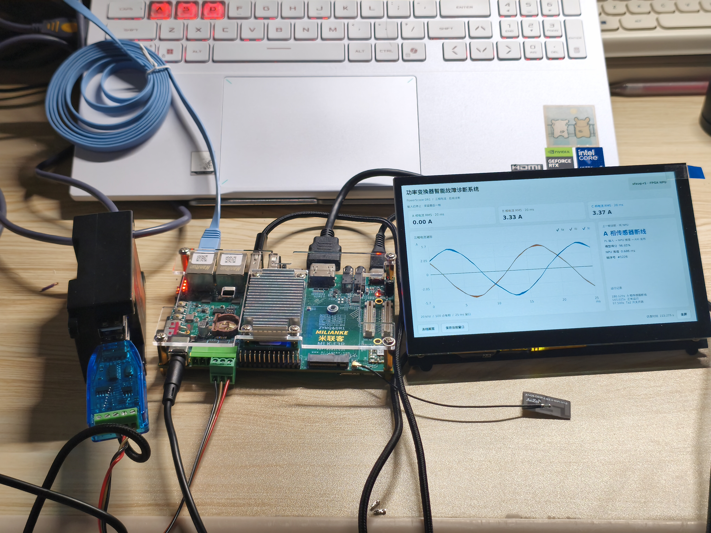
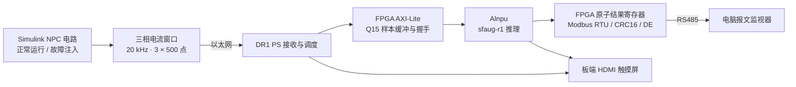

# 功率变换器智能故障诊断系统 · PowerScope DR1

基于安路飞龙 SoC / DR1 的 FPGA 智能故障诊断系统，将 **Simulink 连续电路仿真、FPGA 数据通路、板端 NPU 推理、HDMI 触摸显示及 RS485 报文回传**连接成完整演示链路。

面向三电平 NPC 逆变器，系统在运行过程中接收三相电流窗口，识别开关开路及电流传感器故障。正式模型为 **`sfaug-r1` 纯 NPU 分类器**，诊断结果直接来自 Alnpu 推理。

[技术报告](docs/presentation/technical-report.pdf) · [作品海报](docs/presentation/poster.pdf) · [演示视频与版本下载](https://github.com/Alan-William/powerscope-dr1-open/releases/tag/v2026.11.04) · [快速开始](docs/QUICKSTART.md)



## 系统链路



## FPGA 与系统实现

- **原创 PL 数据通路**：AXI-Lite 地址路由、758 字样本缓冲、提交/确认/消费握手、原子结果邮箱与结果有效期管理。
- **硬件通信闭环**：FPGA 实现 UART、Modbus RTU、CRC16、RS485 收发方向控制；电脑同时显示原始报文、解析结果与帧号。
- **轻量模型部署**：26,486 参数、22 类故障状态；分段量化的 trunk/head 均在 Alnpu 后端执行。PS 负责调度与显示，正式配置不启用规则覆盖。
- **动态故障演示**：Simulink 电路持续运行，在线切换开关开路、传感器断线/卡死/偏移并恢复，观察实时电流及诊断响应。
- **板端可视化**：HDMI 显示三相电流、有效值、诊断类别、置信度与序号，USB 触摸用于界面操作。
- **逐窗可追溯**：输入 SHA256、PL 返回样本、NPU 序号和 RS485 寄存器关联，日志可导出。

## 实测结果

| 项目 | 结果 | 统计范围 |
| --- | ---: | --- |
| 诊断类别 | 22 类 | 正常 + 12 个开关开路 + 9 类传感器故障 |
| 固定验证集准确率 | **99.09%** | PL Q15 输入，1090 / 1100 |
| 独立事件 E2 测试准确率 | **98.32%** | PL Q15 输入，4326 / 4400 |
| 独立事件 E2 测试准确率 | **98.34%** | F32 直接输入对照 |
| NPU 推理耗时中位数 | **0.678 ms** | 连续联调运行的板端推理计时 |
| 输入到 RS485 接收中位数 | **160.939 ms** | 同一次连续联调的完整通信链路 |
| 输入与 RS485 结果关联 | **2406 / 2406** | 连续正常、Ta2 开路、C 相偏移与恢复流程 |
| Modbus 有效应答 | **3830 / 3830** | 同次运行；CRC、超时、协议错误均为 0 |

指标定义及对应范围见 [验证说明](docs/VALIDATION.md)。20 kHz 为仿真采样频率，25 ms 为每窗信号时长；二者与主机刷新周期、板端传输吞吐量分别统计。

## 运行与源码

```sh
git clone https://github.com/Alan-William/powerscope-dr1-open.git
cd powerscope-dr1-open
python -m pip install -r requirements.txt
python -m pc_monitor --port 18768 --demo-assets assets/pc-demo-manifest.json
```

打开 `http://127.0.0.1:18768/` 使用 RS485 监视器。Simulink 模型构建、板端连接及完整演示步骤见 [快速开始](docs/QUICKSTART.md)；FPGA 与 C++ 构建见 [构建说明](docs/BUILD.md)。

| 目录 | 内容 |
| --- | --- |
| `pl/rtl/`、`pl/sim/` | 原创 Verilog 外设、AXI 路由与 HDL 验证 |
| `board/`、`ps/` | Alnpu C++ worker、MMIO、板端服务与部署工具 |
| `board_display/` | HDMI 触摸屏诊断界面 |
| `pc_monitor/` | RS485 实时报文、波形发送与 Simulink 接口 |
| `simulation/source/`、`matlab/` | 原始 NPC 电路模型、在线故障控制与 MEX 桥源码 |
| `experiments/student/`、`ml/` | 轻量网络、传感器增强、训练、量化及评估代码 |
| `models/sfaug-r1/`、`assets/` | 已选模型权重、ONNX、量化参数与 22 类小型演示样本 |
| `protocol/`、`fixtures/`、`tests/` | 协议实现、固定测试向量与单元测试 |
| `docs/`、`evidence/` | 技术资料、报告、照片与实测摘要 |

公开版本是 2026-11-04 提交阶段的独立源码快照；来源及 SHA256 见 [SOURCE_SNAPSHOT.json](SOURCE_SNAPSHOT.json)。当前实现保留了历史研究对照代码，正式运行以本页和 `sfaug-r1` 配置为准。

## 开源许可

原创代码及随附作品文件采用 [MIT License](LICENSE)。外部 SDK、厂商 IP、MATLAB 与 Qt 等依赖遵守各自许可，详见 [THIRD_PARTY.md](THIRD_PARTY.md)。
